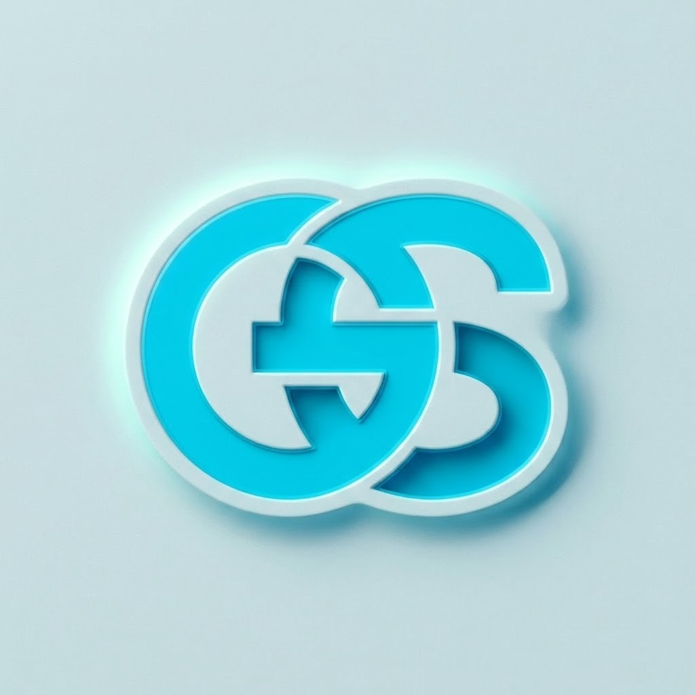

<div align="center">
  

  # GS-Softwares — Portfolio

  **AI agent engineering and digital solutions.** A polished portfolio showcasing intelligent digital systems, autonomous workflows, custom software, and selected projects.

  [](https://gs-softwares.com)
  [](https://nextjs.org/)
  [](https://www.typescriptlang.org/)

  <br />

  
</div>

---

## About

This repository contains the GS-Softwares marketing and portfolio website. It presents the team's capabilities, services, engineering approach, industry solutions, featured work, and a contact inquiry experience in a responsive single-page site.

The project showcase is maintained in `src/data/projectsData.ts` and includes featured and additional projects, their descriptions, technology stacks, statuses, and repository links.

## Highlights

- Responsive portfolio experience built with Next.js App Router.
- Sections for capabilities, services, industry solutions, engineering philosophy, project work, process, and contact.
- Animated and interactive UI elements using Framer Motion and Lucide icons.
- Tailwind CSS styling with reusable UI and layout components.
- Search engine metadata, Open Graph and Twitter metadata, JSON-LD structured data, robots rules, and sitemap.
- Accessibility considerations including semantic landmarks and a skip-to-content link.

## Technology

| Area | Tools |
| --- | --- |
| Framework | Next.js 15, React 19 |
| Language | TypeScript |
| Styling | Tailwind CSS, PostCSS |
| UI and motion | Lucide React, Framer Motion |
| Validation and utilities | Zod, clsx, tailwind-merge |

## Getting started

### Requirements

- Node.js (a current LTS release is recommended)
- npm

### Install dependencies

```bash
npm install
```

### Run the development server

```bash
npm run dev
```

Open [http://localhost:3000](http://localhost:3000) in your browser.

### Build and run for production

```bash
npm run build
npm run start
```

## Available scripts

| Command | Description |
| --- | --- |
| `npm run dev` | Start the Next.js development server. |
| `npm run build` | Create an optimized production build. |
| `npm run start` | Start the production server (after building). |
| `npm run lint` | Run the configured Next.js lint command. |
| `npm run typecheck` | Check TypeScript types without emitting files. |

## Project structure

```text
.
├── favicon.jpg             # Main project icon used above
├── public/                 # Static assets
├── src/
│   ├── app/                # App Router pages, metadata, and global styles
│   ├── components/
│   │   ├── ai-visualization/
│   │   ├── layout/
│   │   ├── sections/
│   │   └── ui/
│   ├── data/               # Portfolio project data
│   └── lib/                # Shared utilities
├── tests/                  # Project verification and test scripts
└── package.json
```

## Updating project content

Edit `src/data/projectsData.ts` to add or update portfolio entries. Each project includes a name, description, industry, status, technology stack, key features, and GitHub URL; a live URL can be included when available.

## Links

- Website: [gs-softwares.com](https://gs-softwares.com)
- GitHub organization: [gs-softwares-code](https://github.com/gs-softwares-code)
- Portfolio repository: [gs-softwares-code/portfolio](https://github.com/gs-softwares-code/portfolio)

---

<div align="center">
  Built with Next.js, React, and TypeScript.
</div>
