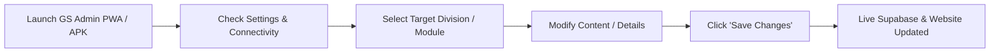

# Standard Operating Procedure (SOP)
## GS-Softwares — Administration Application, Mobile App & PWA Console

**Document Version:** 1.0.0  
**Effective Date:** November 2026  
**Target Audience:** GS-Softwares Leadership, Technical Leads, Operations Team, Systems Administrator  
**Application ID:** `com.gssoftwares.admin`  
**Platforms Supported:** Mobile/Tablet Android (`.apk`), Browser / PWA (`/admin`)  

---

## 1. Purpose & Scope

This Standard Operating Procedure (SOP) outlines the administrative protocols, live content orchestration workflows, publishing procedures, backup routines, and incident management steps for the **GS-Softwares Admin Console**.

The application is architected as an **offline-resilient, dynamic management console** that enables GS-Softwares administrators to update live website services, industry solutions, portfolio case studies, and lead intake without writing code or redeploying the site.

---

## 2. System Access & Platform Options

| Platform | Access Method | Intended Use Case |
| :--- | :--- | :--- |
| **Installed PWA / Web Browser** | Open `https://gs-softwares-official.vercel.app/admin` and click **"Install App"** | Laptops, desktop workstations, iPads/tablets, Android/iOS devices |
| **Android Native App (`.apk`)** | Install `gs-admin.apk` on Android phones/tablets | Mobile admin changes, client demo management, on-the-go updates |

---

## 3. Daily Standard Operating Workflow



### 3.1 Initial Setup & Settings Configuration
1. Open the **GS Admin** application.
2. Navigate to the **Settings** tab.
3. Verify or enter your Supabase credentials:
   - **Public Supabase URL:** `https://your-project-id.supabase.co`
   - **Supabase API Key:** Your Project `anon` key or `service_role` secret.
4. Click **"Save Connection & Sync"**.
5. Confirm the status banner indicates `Live data synchronized from database.`

---

## 4. Module-by-Module Operating Procedures

### 4.1 Services Division Management (`Services`)
* **When to Update:** Introducing new engineering capabilities, updating division taglines, or revising technical stack offerings.
* **Steps:**
  1. Navigate to **Services** in the bottom navigation.
  2. Select the division card to update (*Digital Presence, Applications, AI & Automation, Cloud Infrastructure, Security & Compliance, Consulting*).
  3. Modify **Headline**, **Tagline**, or **Description**.
  4. Click **Save Division Changes**.

### 4.2 Industry Solutions Matrix (`Solutions`)
* **When to Update:** Adding new industry verticals (*Hospitality, Health & Fitness, Beauty & Wellness, Retail, Manufacturing, Professional Services*).
* **Steps:**
  1. Navigate to **Solutions** in the bottom navigation.
  2. Select the industry card to update.
  3. Modify **Headline**, **Tagline**, or **Description**.
  4. Click **Save Solution Changes**.

### 4.3 Portfolio Case Studies (`Projects`)
* **When to Update:** Launching a new client project (*Off The Grid Gym, CafeOS, Rupnagar Tailors, etc.*), updating project status, or editing live URLs.
* **Steps:**
  1. Navigate to **Projects** in the bottom navigation.
  2. Select the project card.
  3. Update **Status** (`Completed`, `In Progress`, `Alpha Phase`), **Description**, or **Live URL**.
  4. Click **Save Project Changes**.

---

## 5. Mobile & Android APK Maintenance

### 5.1 Location of Output APK
* **Workspace Build Tree:** `android/app/build/outputs/apk/debug/app-debug.apk`
* **Public Download Location:** `public/gs-admin.apk`

### 5.2 Soft-Keyboard Handling
As established in Section 8 of the operational guidelines, `android:windowSoftInputMode="adjustResize"` is active in `AndroidManifest.xml` to prevent mobile soft-keyboards from covering input fields.

### 5.3 Recompiling the APK
When native dependencies or configurations change:
```powershell
# 1. Set environment variables
$env:JAVA_HOME = "C:\Program Files\Eclipse Adoptium\jdk-21.0.13.9-hotspot"
$env:ANDROID_HOME = "$env:LOCALAPPDATA\Android\Sdk"
$env:Path = "$env:JAVA_HOME\bin;$env:ANDROID_HOME\platform-tools;$env:Path"

# 2. Rebuild Android APK
cd android
.\gradlew assembleDebug

# 3. Update public artifact
Copy-Item "app\build\outputs\apk\debug\app-debug.apk" "..\public\gs-admin.apk" -Force
```

---

## 6. Troubleshooting & FAQ

| Problem | Cause | Resolution |
| :--- | :--- | :--- |
| **"Configure your Supabase URL & Key in Settings"** | No credentials in local storage | Go to the **Settings** tab and input your Supabase URL and Key. |
| **Mobile keyboard covering inputs in APK** | Fixed with `adjustResize` | Ensure the latest rebuilt APK is installed (`android:windowSoftInputMode="adjustResize"`). |
| **New changes not showing on mobile site** | Visitor browser cache | Perform a hard refresh (`Ctrl+F5` or clear browser site data). |
| **Database update error: permission denied** | Supabase RLS policy | Verify that the policies from `supabase-schema.sql` are executed in your Supabase SQL editor. |

